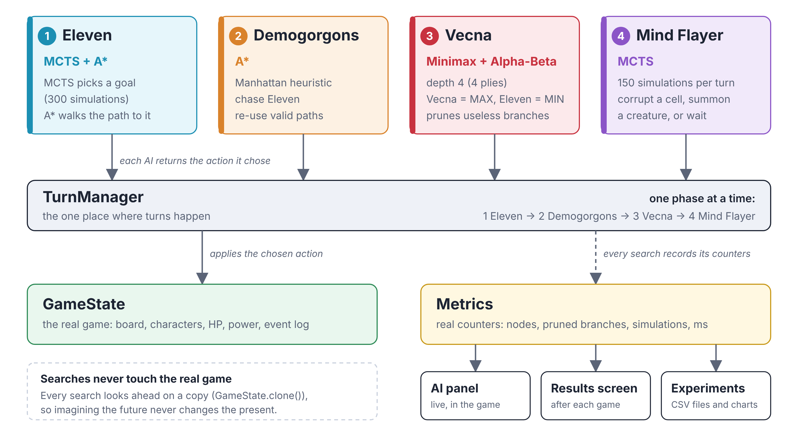

# Escape the Upside Down

A turn-based strategy game on a 15x15 grid, inspired by *Stranger Things*, in which every character is controlled by a real AI search algorithm. Eleven must rescue her four friends, defeat the Mind Flayer and escape through the gate. You can play Eleven yourself against the AIs, or watch the AIs play each other while the side panel shows every search statistic live.

The project demonstrates four classic AI techniques working together in one game: **A\***, **Minimax with Alpha-Beta pruning**, and **Monte Carlo Tree Search (MCTS)** used twice (for Eleven and for the Mind Flayer). It also includes a batch experiment runner that measures how well they work, with charts and confidence intervals.

Built for the AI Lab course at Khulna University of Engineering & Technology (KUET), in Python with pygame.

## Table of contents

1. [Highlights](#highlights)
2. [The algorithms at a glance](#the-algorithms-at-a-glance)
3. [Game rules](#game-rules)
4. [The board](#the-board)
5. [The AI in detail](#the-ai-in-detail)
6. [Installation](#installation)
7. [Playing the game](#playing-the-game)
8. [Configuration](#configuration)
9. [Experiments](#experiments)
10. [Tests](#tests)
11. [Project structure](#project-structure)
12. [Design decisions](#design-decisions)
13. [Known limitations](#known-limitations)
14. [Troubleshooting](#troubleshooting)
15. [Team and credits](#team-and-credits)

## Highlights

- Four characters, each driven by a different algorithm, all running on the same game rules.
- Human vs AI mode and a fully automatic AI vs AI mode with pause, step and speed control.
- A live AI panel: nodes explored, branches pruned, simulations, search time, and each algorithm's last decision, including the value of the options it rejected.
- **No fake numbers.** Every number on screen comes from a real search run (see [The honesty rule](#the-honesty-rule)).
- Random boards: the walls are fixed, and the placements are generated from a seed. The seed is shown on screen, so any game can be replayed.
- Pictures, animations (slides, hit and kill flashes, a swirling gate), sound effects generated in code, and a colour-coded, scrollable event log.
- A batch runner (`experiments/run_batch.py`) that plays hundreds of games in parallel and saves CSV files, plus a chart script.
- About 370 automated tests, including headless tests of the interface.

## The algorithms at a glance

| Character | Algorithm | What it decides |
|---|---|---|
| Eleven | MCTS + A\* | MCTS chooses a strategic goal (rescue a friend, hunt a Demogorgon, evade, final attack, use an ability). A\* then walks the path to that goal. |
| Demogorgons | A\* (Manhattan heuristic) | Chase Eleven and re-plan when another character blocks the path. |
| Vecna | Minimax with Alpha-Beta pruning | Picks his move by looking 4 plies ahead (Vecna maximises, Eleven minimises). |
| Mind Flayer | MCTS | Each turn: corrupt a cell, summon a temporary creature, or wait. |

## Game rules

### Goal

Eleven wins by doing three things in order:

1. Rescue all 4 friends (Mike, Dustin, Lucas, Will).
2. Defeat the Mind Flayer with the final attack.
3. Reach the gate.

She loses if her HP reaches 0 or if 150 turns pass.

### Turn order

Each turn has four phases: **Eleven**, then the **Demogorgons**, then **Vecna**, then the **Mind Flayer** (only once it is awake). Eleven acts once per turn (twice while Speed is active).

### Eleven

| | |
|---|---|
| Starting HP / power | 5 HP, 1 power |
| Maximum power | 15 |
| Move | One cell up, down, left or right (never diagonally) |
| Wait | Skip the action |
| Attack | Hits a Demogorgon within 1 cell. Costs 1 power, and a kill gives +3 power. |
| Rescue | Saves a friend within 1 cell. Gives +4 power. |
| Abilities | Speed, Teleport, Freeze (see below) |
| Final attack | Defeats the Mind Flayer (see below) |

Walls, the map edge, other characters, corrupted cells and the closed gate block movement.

### Enemies

- **Demogorgons** (2 on a generated board by default) hit Eleven for 1 HP when adjacent. After a hit a Demogorgon waits one turn. They can be killed. The kill gives Eleven +3 power.
- **Vecna** hits Eleven for 2 HP when she is within 1 cell. He has no cooldown. He **cannot be killed**, only frozen.
- **Hazard cells** cost Eleven 1 HP each time she enters one.
- **Vine cells** are passable and drawn like normal floor (no gameplay effect).
- **Mind Flayer creatures** (summoned Demogorgons) behave like Demogorgons but give no power when killed. At most 3 exist at once.

### Friends and abilities

Rescuing a friend gives Eleven +4 power. Three friends are linked to an ability. All three are ready from the start, and each can be used once:

| Key | Ability | Friend | Effect |
|---|---|---|---|
| 1 | Speed | Lucas | Two moves per turn for 3 turns |
| 2 | Teleport | Mike | Jump to a safe cell: enterable, not the gate, at least 3 cells from every enemy. A human clicks any such cell. The AI only chooses among cells Eleven has already visited, picking the one whose nearest enemy is farthest away. |
| 3 | Freeze | Will | Every Demogorgon and Vecna skips their turns for 2 turns |

### The Mind Flayer

The Mind Flayer is **asleep until Will is rescued**. It has no position on the board. Once awake, it acts once per turn, after Vecna:

- **Corrupt a cell:** nobody can enter it for 2 full turns. At most 4 cells are corrupted at once. The gate cell can never be corrupted.
- **Summon a creature:** a temporary Demogorgon appears 2 to 4 steps from Eleven. At most one summon every 4 turns.
- **Wait.**

### The final attack

The final attack (key **X**) needs the Mind Flayer to be **awake**, Will **rescued**, and at least **10 power**. It costs 10 power, defeats the Mind Flayer and opens the gate. Until then the gate cell is closed and Eleven cannot step on it. When all friends are rescued, the Mind Flayer is defeated and Eleven stands on the gate, she escapes.

## The board

The board is a 15x15 grid. The **wall layout is fixed** (every board is a known-good maze). Every new game can generate new **placements** from a seed: the gate, the four friends, the Demogorgons and the hazard cells. Eleven and Vecna keep their corners.

The generator follows rules from `config.py`, all measured by walking distance (not straight lines):

- the gate is at least 20 steps from Eleven's start;
- each friend is at least 8 steps from Eleven and 6 from Vecna, and at least 6 from each other;
- Demogorgons start at least 6 steps from Eleven, 4 from each other and 3 from every friend and the gate;
- hazards never start next to Eleven, and walking around one costs at most 2 extra steps.

Every generated board is checked so that everything is reachable. If 500 placement attempts fail, the generator falls back to the default map. The same seed always gives the same board. In `config.py`, `RANDOM_BOARD_PER_GAME = False` always uses the default map.

## The AI in detail

### A\* (pathfinding)

A\* finds the shortest path on the 4-connected grid with `f(n) = g(n) + h(n)`, where `h` is the Manhattan distance. This heuristic never overestimates on this grid, so the returned path is optimal. Design decisions:

- Walls, map edges and corrupted cells are impassable.
- Other characters are treated as **obstacles** for every caller. The start and goal cells are always exempt (a Demogorgon's goal *is* Eleven's cell, and the final step onto it means "attack").
- Step cost is 1 by default. Eleven's A\* uses higher costs for hazard cells (3) and for cells where an enemy could hit her this turn (+5), so she detours when that is cheaper.
- Ties are broken by smaller `h`, then by insertion order, so results are fully deterministic.

### Demogorgons

Each Demogorgon runs A\* towards Eleven. It keeps its last path and re-uses it only while the target and the cells on the path are still valid. When Eleven moves, a fresh search runs. Re-used paths are counted separately and never reported as searches.

### Vecna: Minimax with Alpha-Beta pruning

Vecna looks 4 plies ahead (Vecna, Eleven, Vecna, Eleven). **Vecna is MAX and Eleven is MIN.**

- Eleven's modelled replies are: step, attack, rescue, wait. Abilities and the final attack are not modelled.
- Demogorgons are treated as static obstacles inside the search, and the Mind Flayer is not modelled.
- Every node works on a clone of the state. The live game is never touched.
- **Terminal states** score exactly +50 (Eleven dies) or -50 (Eleven escapes), and **every other state stays strictly between -49 and +49**, so a real win or loss always beats any estimate.
- **The evaluation** (positive means good for Vecna) combines: +8 per HP Eleven has lost, up to +6 for standing next to her, -2 per rescued friend, and up to -4 when the gate is open and Eleven is close to it. Distances use a precomputed table of walking distances, so each lookup is instant.
- Move ordering (attack first, then closing in or fleeing) only changes how much Alpha-Beta can prune. It never changes the answer.
- Counters: `nodes_visited` (every node entered), `nodes_evaluated` (leaves scored) and `branches_pruned` (moves skipped by cutoffs; always 0 with Alpha-Beta off).

Alpha-Beta can be switched off in the Settings screen (plain Minimax) for comparison. The experiments show it always gives the same move and score.

### Eleven: MCTS chooses the goal, A\* walks to it

Eleven's decisions have two levels:

- **WHAT:** MCTS chooses a strategic **goal**: rescue one friend, hunt the nearest Demogorgon, evade (go to the safest nearby cell), final attack, use an ability, or go to the gate (only after all friends are rescued and the gate is open).
- **HOW:** A\* turns the goal into one move per turn.

This keeps the MCTS tree small enough to search in real time. The four MCTS steps:

1. **Selection:** UCB1, `Q/N + c * sqrt(ln(N_parent) / N)` with `c = 1.41`.
2. **Expansion:** one untried goal, executed on a clone of the parent's state.
3. **Simulation:** random goals until 15 simulated turns have passed or the game ends.
4. **Backpropagation:** every node on the path receives the reward from its own edge onward.

Details:

- One tree edge is one goal executed for up to 6 turns.
- 300 simulations per search by default.
- Rewards are divided by 50, so values stay near 1 and the UCB1 constant keeps its meaning.
- Searches are seeded (`RNG_SEED` plus the turn number), so the same game always plays out the same way.
- Inside the search, Demogorgons and Vecna are modelled by a cheap stand-in (hit when adjacent, otherwise step to the free neighbour closest to Eleven). The real game still uses A\* and Minimax for them.
- **When does Eleven re-plan?** When she has no goal, the goal is finished, the goal is older than 2 turns, she lost HP since the plan was made, or an enemy came within 2 steps.
- Rescuing Will last is enforced (`ELEVEN_RESCUE_WILL_LAST`), and abilities are only offered as goals while an enemy is within 3 steps.

**Rewards used by Eleven's MCTS:**

| Event | Reward |
|---|---|
| Escape | +50 |
| Defeat the Mind Flayer | +25 |
| Rescue a friend | +10 |
| Defeat a Demogorgon | +2 |
| Gain power | +1 (per point) |
| Progress towards the nearest objective | +0.5 (per cell) |
| Lose HP | -5 (per HP) |
| Vecna close (danger) | -8 |
| Death | -50 |

### Mind Flayer: MCTS

The Mind Flayer wakes when Will is rescued. Every turn a search of 150 simulations picks one action: corrupt a cell, summon a creature, or wait.

- One tree edge is the Mind Flayer's action plus one simulated turn. The search looks 6 turns ahead.
- To keep the tree small, it considers at most 8 corrupt cells (taken from the first cells of Eleven's expected route) and 3 summon cells.
- Eleven is modelled by a stand-in that follows her expected route.
- It considers Eleven **trapped** when she can enter at most 1 neighbouring cell.

**Rewards used by the Mind Flayer's MCTS:**

| Event | Reward |
|---|---|
| Kill Eleven | +50 |
| Damage Eleven | +10 |
| Block her route | +5 |
| Trap Eleven | +4 |
| Force her away | +3 |
| Defeated by the final attack | -25 |
| Eleven escapes | -50 |

### How the algorithms work together



All searches run on clones of the state (`GameState.clone()`), so a search can imagine the future without changing the real game.

### The honesty rule

Every number shown in the game (nodes explored, nodes evaluated, branches pruned, simulations, search time) is counted by `ai/metrics.py` during the real searches. Nothing is estimated, rounded up or random. If an algorithm has not run yet, the panel says "no search yet" instead of showing a made-up number.

## Installation

You need Python 3.10 or newer (developed with 3.12).

```
pip install pygame pytest matplotlib
```

- `pygame` is needed to run the game.
- `pytest` is needed to run the tests.
- `matplotlib` is only needed for the result charts.

Sounds are generated in code and the pictures are included, so there is nothing else to download.

## Playing the game

Run this from the project folder (the one that contains `config.py`):

```
python main.py
```

### Menu

| Item | What it does |
|---|---|
| Human vs AI | You play Eleven. The enemies are controlled by their AIs. |
| AI vs AI | Eleven is controlled by MCTS too. You watch. |
| How to Play | The rules in short form |
| AI Algorithms | Short explanations of the four algorithms, with the current settings |
| Settings | AI-vs-AI start speed, Alpha-Beta on/off, new seed per game or fixed seed, sound on/off |

### Controls

| Key | Action |
|---|---|
| WASD / arrow keys | Move one cell |
| Space | Wait (in AI mode: pause and resume) |
| E | Attack an adjacent Demogorgon |
| F | Rescue a friend in range |
| 1 / 2 / 3 | Speed / Teleport (then click a highlighted cell) / Freeze |
| X | Final attack |
| Esc | Cancel a Teleport |
| T | Switch AI vs AI on or off |
| N | Let the AI play one turn (also works in human mode) |
| + / - | AI speed: 0.5x, 1x, 2x, 4x |
| P | Show paths: A\* paths, Eleven's goal and Vecna's last choice |
| R | Restart with a new game |
| M | Back to the menu |
| Mouse wheel / PageUp / PageDown / End | Scroll the event log (End jumps to the newest) |
| F11 | Full screen |

The on-screen buttons (Pause, Step, Slower, Faster, AI play, Paths, Restart, Menu) do the same things.

### The game screen

- **Top strip:** Eleven's hearts and power bar, the turn counter, rescued friends, abilities with their uses left, and the Mind Flayer's state (asleep, awake, defeated).
- **Board:** the characters and their pictures. Corrupted cells have a purple frame, summoned creatures are tinted purple, and when the Mind Flayer is awake it looms over the board.
- **AI panel (right):** the control buttons, key hints, Eleven's current goal and the game seed, then four cards:
  - **A\* pathfinding:** searches and nodes for the Demogorgons and for Eleven.
  - **Vecna: Minimax:** mode, depth, total nodes evaluated and pruned, the last decision with its score, and the values of the options he rejected.
  - **Eleven: MCTS goal:** searches, simulations, average time, the chosen goal with its visits and value, and the top alternatives.
  - **Mind Flayer: MCTS:** the same for its actions.
- **Event log:** the history of the game, colour-coded by kind (damage, kills, rescues, abilities, Mind Flayer, win, loss).

### Results screen

When the game ends, Enter opens a summary: winner, turns played, friends rescued, Demogorgons defeated, Mind Flayer state, final HP and power, the game seed, and the total search statistics of every algorithm.

## Configuration

Every balance value lives in `config.py`. Nothing is hidden elsewhere. The most important settings:

| Setting | Default | Meaning |
|---|---|---|
| `MAX_HP` / `START_POWER` / `MAX_POWER` | 5 / 1 / 15 | Eleven's health and power |
| `MAX_TURNS` | 150 | Turn limit |
| `FINAL_POWER_REQUIREMENT` | 10 | Power needed (and spent) by the final attack |
| `RESCUE_POWER_BONUS` | 4 | Power per rescued friend |
| `DEMOGORGON_COUNT` | 2 | Demogorgons on a generated board |
| `MINIMAX_DEPTH` | 4 | Vecna's search depth in plies |
| `VECNA_USE_ALPHA_BETA` | True | False gives plain Minimax |
| `ELEVEN_MCTS_SIMULATIONS` | 300 | Eleven's simulations per search |
| `MINDFLAYER_MCTS_SIMULATIONS` | 150 | The Mind Flayer's simulations per search |
| `MCTS_EXPLORATION` | 1.41 | The UCB1 constant |
| `MCTS_ROLLOUT_DEPTH` | 15 | Turns simulated at the end of a rollout |
| `MCTS_GOAL_TURNS` | 6 | Longest goal in one tree edge |
| `ELEVEN_REPLAN_TURNS` | 2 | How long a goal is kept before MCTS re-plans |
| `ELEVEN_RESCUE_WILL_LAST` | True | Will is rescued last |
| `MF_CORRUPT_DURATION` | 2 | Turns a corrupted cell stays blocked |
| `MF_MAX_CORRUPTED` / `MF_SPAWN_COOLDOWN` | 4 / 4 | Corrupted cells at once / turns between summons |
| `RNG_SEED` | 42 | Seed used when `RANDOM_SEED_PER_GAME` is False |
| `RANDOM_SEED_PER_GAME` / `RANDOM_BOARD_PER_GAME` | True / True | New seed and new board for every game |
| `AI_TURN_DELAY_MS` / `AI_SPEEDS` | 600 / (0.5, 1, 2, 4) | AI vs AI pace |
| `SPRITES_ENABLED` / `ANIM_ENABLED` / `SOUND_ENABLED` | True | Pictures, animations, sound |

## Experiments

`experiments/run_batch.py` plays many games with no window and saves the results as CSV files. It uses the normal rules and the normal AIs. Run all commands from the project folder.

```
python experiments/run_batch.py smoke                                         # 2 tiny games, checks that everything works
python experiments/run_batch.py minimax --games 10 --tag final                # Alpha-Beta against plain Minimax
python experiments/run_batch.py mcts --games 20 --workers 4 --tag final       # Eleven MCTS budgets
python experiments/run_batch.py mf-budget --games 20 --workers 4 --tag final  # Mind Flayer MCTS budgets
python experiments/run_batch.py mf-effect --games 20 --workers 4 --tag final  # Mind Flayer on versus off
python experiments/run_batch.py sweep --param MF_CORRUPT_DURATION --values 1,2,3 --games 20 --workers 4
python experiments/plot_results.py --tag final                                # charts from the saved results
```

Options: `--games N`, `--seed-start 1000`, `--workers 4` (games in parallel), `--tag NAME` (added to the file names), `--out FOLDER`, `--eleven-sims N` and `--mf-sims N`.

### How the experiments stay fair

- All settings of one experiment play the **same seeds** (`seed-start`, `seed-start + 1`, ...), so the comparison is paired.
- The seed changes the MCTS seeds. The map and the rules are fixed, so games with different seeds are similar, not independent. Report win rates as "x of N games".
- Win rates come with a 95% confidence interval (Wilson). With 20 games the interval is wide, so overlapping intervals mean the difference is not proven.
- Config values are changed only while a game runs, and restored afterwards.
- A game that crashes becomes an error row. It never stops the batch.

### Output files

Every run writes three files into `experiments/results/`:

| File | Contents |
|---|---|
| `<name>_<tag>_games.csv` | One row per game (MCTS, sweeps) or per search (Minimax): outcome, turns, HP, power, friends rescued, and the real search counters |
| `<name>_<tag>_summary.csv` | The averages per setting, with win rate and confidence interval. This is the table for the report. |
| `<name>_<tag>_meta.json` | Every `config.py` value, the Python version, the date and the exact command, so the run can be reproduced |

`plot_results.py` saves PNG charts into `experiments/results/plots/`: `winrate_<name>_<tag>.png` (win rate with error bars), `minimax_<tag>.png` (nodes and time per depth, plain against Alpha-Beta) and `time_<name>_<tag>.png` (search time against simulation budget).

### Results: Alpha-Beta against plain Minimax

113 real positions taken from 10 games, searched by both versions at each depth. Alpha-Beta chose **the same move and the same score as plain Minimax in all 113 positions at every depth**, so it only saves work and never changes the answer.

| Depth | Nodes visited (plain) | Nodes visited (Alpha-Beta) | Fewer nodes | Time (plain) | Time (Alpha-Beta) | Speedup |
|---|---|---|---|---|---|---|
| 2 | 15.0 | 9.8 | 34.5% | 1.39 ms | 1.38 ms | 1.01x |
| 3 | 51.2 | 23.4 | 54.3% | 1.75 ms | 1.55 ms | 1.13x |
| 4 | 176.6 | 46.7 | 73.5% | 16.21 ms | 7.65 ms | 2.12x |
| 5 | 593.2 | 97.5 | 83.6% | 21.04 ms | 8.50 ms | 2.48x |

The saving grows with depth. Plain Minimax multiplies its work by about 3.4 for every extra level, Alpha-Beta by about 2. At depth 2 there is almost nothing to prune, and the bookkeeping cancels the gain. The game uses depth 4, where the search takes about 7.7 ms. Times were measured on one development machine and depend on the computer; node counts and win rates do not.

### Results: Eleven MCTS budget

20 games per setting on the same seeds (1000 to 1019).

| Simulations per search | Win rate | 95% interval | Avg. friends rescued (of 4) | Avg. turns | Time per search |
|---|---|---|---|---|---|
| 50 | 25% | 11% to 47% | 3.05 | 91.3 | 141 ms |
| 150 | 70% | 48% to 86% | 3.75 | 91.7 | 293 ms |
| 300 (default) | 80% | 58% to 92% | 3.80 | 86.9 | 336 ms |
| 600 | 85% | 64% to 95% | 3.85 | 84.8 | 359 ms |

More search means a better plan, with diminishing returns. The 300 and 600 intervals overlap strongly, so the two are not clearly different, and 300 simulations is a good trade-off. Search time does not grow in proportion to the budget (12 times more simulations took about 2.5 times the time), so part of each search is a fixed cost.

### Results: the Mind Flayer

*To be added after the final experiment run (`mf-effect`, `mf-budget` and the `MF_CORRUPT_DURATION` sweep).*

## Tests

```
python -m pytest -q
```

The suite (about 370 tests) covers the game rules, A\*, Minimax (including Alpha-Beta against plain Minimax), both MCTS searches, abilities, board generation, the animation, sound, event log and interface (headless, with a dummy display and audio), the experiment runner and the chart script. All tests should pass. The full run takes a few minutes.

## Project structure

```
main.py                     Entry point: window, screen switching, input
config.py                   Every balance and AI setting

game/
  board.py, board_gen.py    The grid, terrain, validation, random placements
  state.py                  GameState (with a fast clone())
  actions.py, rules.py      Eleven's actions and the one place they change the state
  vecna_rules.py            Vecna's actions (shared by the game and Minimax)
  mind_flayer_rules.py      Corrupt / summon / wait
  turn_manager.py           The turn phases and the AI hooks

characters/                 Eleven, friends, Demogorgon, Vecna, Mind Flayer
abilities/                  Speed, Teleport, Freeze

ai/
  astar.py                  A* search
  demogorgon_ai.py          Demogorgon controller (A* with path reuse)
  minimax.py, evaluation.py Minimax + Alpha-Beta and Vecna's evaluation
  vecna_ai.py               Vecna controller
  mcts.py                   MCTS for Eleven
  goals.py, navigation.py   Strategic goals and the A* navigator
  sim.py                    Fast turn simulation used inside MCTS
  eleven_ai.py              Eleven controller (re-planning, MCTS + A*)
  mind_flayer_ai.py         MCTS for the Mind Flayer
  distance_table.py         Precomputed walking distances
  metrics.py                The real search counters

ui/                         Game screen, menus, results, AI panel, icons, sprites,
                            animation, sound, event log, theme
assets/characters/          Character pictures
experiments/                run_batch.py, plot_results.py (and results/)
tools/split_sprites.py      Helper for cutting sprites out of a sheet
tests/                      Automated tests
```

## Design decisions

- **Searches never touch the live game.** Every search runs on `state.clone()`, so the AI can look ahead without changing anything. Applying a move always goes through one function, so the real game, Minimax and MCTS share exactly the same rules.
- **Two levels for Eleven.** MCTS decides the goal and A\* walks to it. Searching over individual moves would need a far deeper tree for the same plan.
- **Fast stand-ins inside searches.** Inside MCTS, the enemies follow a cheap policy so that 300 simulations stay fast. The real game still uses A\* and Minimax for them.
- **The Mind Flayer is not on the board.** It acts on the map, so the final attack needs no adjacency.
- **Will is rescued last.** With Will rescued in any order, Eleven won 0 of 30 games, against 83% with Will last. The same 0% occurred with the Mind Flayer switched off, so the Mind Flayer's actions are not the cause. The exact cause is not yet traced.
- **Corruption lasts 2 turns.** Three turns made the game much harder (about 4 of 20 wins against about 12 of 20 in early tests), and a corrupted cell is never permanent.
- **Fixed walls, random placements.** Random walls could produce unwinnable boards. Random placements on a known-good maze keep the game fair and varied.
- **No fog of war.** It would make Eleven's search far harder without adding to the algorithm demonstration.
- **Sound is generated in code**, so the project has no audio files to manage.

## Known limitations

- **One map family.** The walls are fixed. Results are for this maze and its random placements.
- **Simplified models inside searches.** Minimax models only Vecna and Eleven (Demogorgons stay still, no abilities, no Mind Flayer), and Eleven's MCTS models the enemies with a stand-in. This is a deliberate speed trade-off.
- **Games are not independent.** Different seeds change the MCTS random choices, not the map, so confidence intervals are slightly optimistic.
- **The Mind Flayer's effect on the win rate is small.** It wakes only when the last friend is rescued, and Eleven can usually defeat it within a few turns. Its search still runs for real and shows in the statistics.
- **Eleven's AI is not perfect.** She sometimes arrives at the end with low HP, and she never wins every game. This is intended: it makes the game worth watching.

## Troubleshooting

| Problem | Fix |
|---|---|
| `ModuleNotFoundError: pygame` | Run `pip install pygame` |
| `matplotlib is not installed` when plotting | Run `pip install matplotlib` |
| `No module named 'config'` or `ui` | Run the command from the project folder (the one containing `config.py`), not from a subfolder |
| A pygame warning "no fast renderer available" | Harmless. It appears when the display falls back to software rendering. |
| No sound | Set `SOUND_ENABLED = True` in `config.py` or switch it in Settings. Make sure your system has an audio device. |
| The window is too tall for the screen | Lower the display scale in your system settings, or reduce `CELL` in `ui/theme.py` |
| Missing pictures | The game shows letters instead. Check `assets/characters/`, or set `SPRITES_ENABLED = False`. |
| Experiments are slow | Use `--workers 4` (or your number of CPU cores). Each game takes a few seconds. |
| Stale results after changing the code | Rerun the experiments with the same `--tag`. They overwrite the old files. |

This is an educational project inspired by *Stranger Things*. It is not affiliated with or endorsed by Netflix or the creators of the series. The names and characters belong to their owners.
